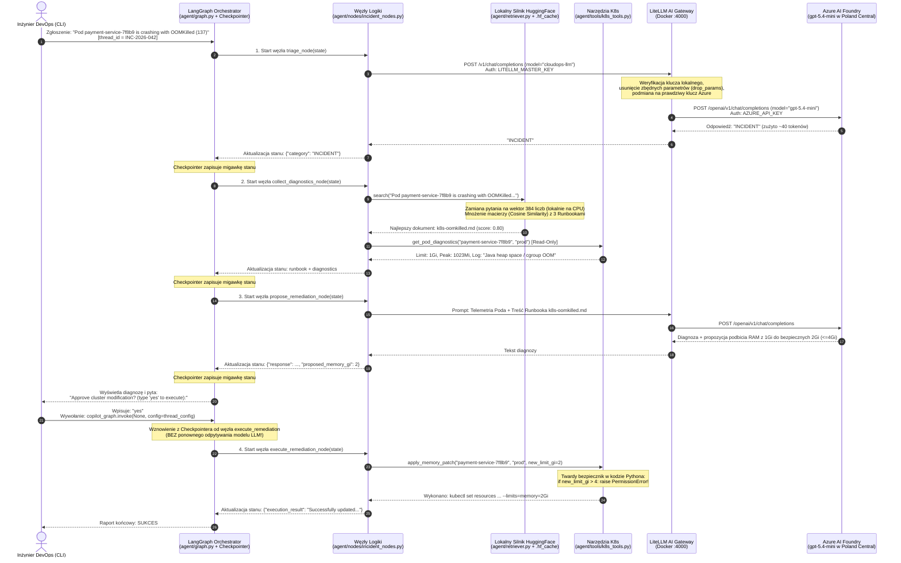
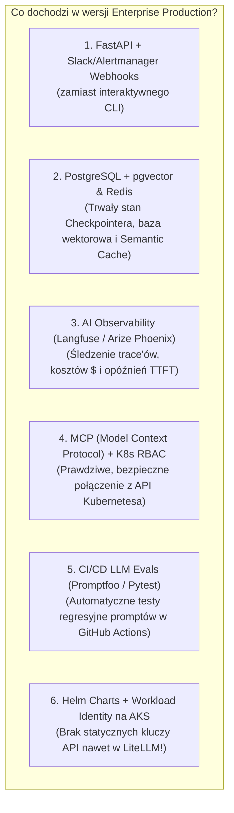

# Architektura i Kompendium LLMOps: CloudOps Incident Copilot

Ten dokument stanowi kompletne kompendium wiedzy inżynierskiej dla zbudowanej przez nas platformy referencyjnej LLMOps. Wyjaśnia krok po kroku mechanizmy działania systemu, architekturę każdej z 4 warstw technologicznych (**Azure AI Foundry**, **LiteLLM**, **HuggingFace**, **LangGraph**), uzasadnienie biznesowo-produkcyjne (dlaczego i kiedy firmy budują takie platformy) oraz mapę drogową do wdrożenia klasy Enterprise na Kubernetesie (AKS).

---

## 1. O co w tym wszystkim chodzi? (Główny problem, który rozwiązujemy)

W klasycznym podejściu do AI początkujący programiści robią jedną rzecz: biorą klucz API do OpenAI lub Azure, wpisują go bezpośrednio do skryptu w Pythonie i wysyłają zapytanie do modelu.

W prawdziwej firmie (szczególnie w zespołach **DevOps / SRE / CloudOps / FinTech**) takie podejście nie przechodzi przez żaden audyt bezpieczeństwa ani architektury z **5 powodów**:

1. **Halucynacje i brak znajomości wewnętrznych reguł firmy:** Publiczny model LLM wie, czym ogólnie jest `OOMKilled` w Kubernetesie, ale nie ma pojęcia, jakie są wewnętrzne procedury Twojej firmy (np. że bez zgody zespołu Platform Engineering na kanale `#sre-war-room` nie wolno podnieść limitu RAM powyżej `4Gi`).
2. **Nieprzewidywalność i ryzyko zniszczenia produkcji:** Jeśli dasz modelowi AI bezpośredni dostęp do terminala (`kubectl` / `terraform`), zły prompt lub halucynacja może skasować produkcyjny namespace albo wywołać pętlę 500 zapytań z rzędu.
3. **Vendor Lock-in i awarie chmury:** Jeśli w kodzie 20 mikroserwisów zaszyjesz na sztywno wywołania konkretnej wersji modelu (np. `gpt-4o-mini`), to w dniu wycofania tej wersji przez Microsoft albo podczas awarii regionu musisz przepisywać i wdrażać od nowa wszystkie aplikacje.
4. **Wyciek sekretów i brak kontroli kosztów (FinOps):** Rozdawanie głównego klucza `AZURE_API_KEY` każdemu kontenerowi i deweloperowi oznacza, że w razie wycieku lub błędu w kodzie ktoś może nabić rachunek na kilkadziesiąt tysięcy dolarów w jedną noc.
5. **Koszty i prywatność danych:** Wysyłanie całych repozytoriów dokumentacji (setek Runbooków i post-mortemów) w każdym zapytaniu do chmury byłoby ekstremalnie drogie i wolne.

Nasz projekt (**CloudOps Incident Copilot**) rozwiązuje każdy z tych 5 problemów, łącząc 4 wyspecjalizowane technologie w jedną spójną architekturę.

---

## 2. Jak to wszystko działa pod spodem? (Przepływ End-to-End krok po kroku)

Spójrzmy na dokładny przebieg życia jednego zgłoszenia incydentu - od momentu uruchomienia kontenera aż do wykonania bezpiecznej naprawy na klastrze:



### Rola każdego pliku w repozytorium:
* `infra/main.tf`, `infra/providers.tf`, `infra/outputs.tf` - definicja infrastruktury IaC w Terraformie (Grupa Zasobów, konto Azure AI Foundry `AIServices` z tożsamością `SystemAssigned` oraz wdrożenie modelu `gpt-5.4-mini` z limitem `30K TPM`).
* `gateway/litellm_config.yaml` - konfiguracja bramki AI (definicja wirtualnego modelu `cloudops-llm`, zapasowego modelu `cloudops-fallback` w HuggingFace, reguł retry/cooldown oraz flagi `drop_params: true`).
* `data/runbooks/*.md` - nasza wewnętrzna baza wiedzy SRE (procedury dla `OOMKilled`, `CrashLoopBackOff` oraz `HTTP 429` w Azure).
* `agent/retriever.py` - lokalny silnik wektorowy oparty o `sentence-transformers` i model `BAAI/bge-small-en-v1.5`, zamieniający pliki Markdown na macierz wektorów `(3, 384)` i liczący podobieństwo cosinusowe (`Cosine Similarity`).
* `agent/tools/k8s_tools.py` - narzędzia wykonawcze podzielone na bezpieczne narzędzia Read-Only (`get_pod_diagnostics`) oraz narzędzia zmieniające stan klastra (`apply_memory_patch`) z twardą blokadą `MAX_ALLOWED_MEMORY_GI = 4`.
* `agent/nodes/incident_nodes.py` - definicja schematu stanu `IncidentState` oraz pojedynczych kroków (węzłów) maszyny stanów.
* `agent/graph.py` - główny orkiestrator łączący węzły w graf `StateGraph`, podpinający `MemorySaver` (`Checkpointer`) oraz bezpiecznik `interrupt_before=["execute_remediation"]`.
* `Dockerfile` & `docker-compose.yml` - definicja zoptymalizowanego obrazu CPU-only (`uv sync --frozen`, non-root `appuser`, `HF_HUB_OFFLINE=1`) i sieci łączącej agenta z bramką LiteLLM.

---

## 3. Głębokie omówienie 4 technologii - co robią i dlaczego są niezbędne?

### 3.1. Azure AI Foundry + Terraform (`infra/`)
**Co robi w projekcie:** Dostarcza zarządzany, korporacyjny punkt końcowy modelu językowego (`gpt-5.4-mini`) w europejskim regionie (`polandcentral`) z twardym limitem przepustowości (30K TPM = 30 000 tokenów na minutę).

**Dlaczego firmy używają Azure AI Foundry zamiast zwykłego konta w OpenAI?**
* **Compliance, RODO i suwerenność danych:** W Azure AI Foundry ruch i dane mogą pozostać na terenie Unii Europejskiej (`polandcentral` / `swedencentral`), a Microsoft gwarantuje w umowie Enterprise, że Twoje prompty i logi produkcyjne **nigdy nie są używane do trenowania modeli**.
* **Sieć prywatna (Private Endpoints) i IAM (Entra ID):** Zasób `azurerm_cognitive_account` (`kind = "AIServices"`) możesz wpiąć w prywatny VNet swojej firmy (tak jak bazę Azure SQL), całkowicie odcinając dostęp z publicznego internetu.
* **Kontrola kosztów przez IaC (Terraform):** Parametr `sku.capacity = 30` w pliku `infra/main.tf` działa jak bezpiecznik prądowy. Nawet jeśli w kodzie powstanie pętla nieskończona, Azure nie pozwoli zużyć więcej niż 30 000 tokenów na minutę.
* **Wbudowany WAF dla AI (`rai_policy_name = "Microsoft.DefaultV2"`):** Chmura automatycznie skanuje każde zapytanie pod kątem prób *Jailbreaku* (przejęcia kontroli nad promptem) i niebezpiecznych treści jeszcze zanim trafi ono do modelu.

---

### 3.2. LiteLLM Proxy (`gateway/litellm_config.yaml`)
**Co robi w projekcie:** Działa w osobnym kontenerze (`llmops-litellm-gateway` na porcie `4000`) jako **AI API Gateway (odpowiednik NGINX Ingress lub Envoy Proxy dla ruchu LLM)**.

**Dlaczego nie łączymy kodu agenta bezpośrednio z Azure, tylko stawiamy pośrodku LiteLLM?**
1. **Unifikacja i brak Vendor Lock-in:** Każdy dostawca chmury (Azure, AWS Bedrock, Google Vertex AI, Anthropic, HuggingFace) ma inne SDK, inne nagłówki i inne adresy URL. LiteLLM wystawia dla wszystkich naszych kontenerów **jeden, ustandaryzowany interfejs OpenAI API** pod wirtualną nazwą modelu `cloudops-llm`. Jeśli jutro zechcesz przełączyć się z Azure na lokalnego Llama-3 lub Claude w AWS, zmieniasz **tylko 3 linijki w `litellm_config.yaml`** - w kodzie Pythona agenta nie zmieniasz absolutnie nic!
2. **High Availability, Retries & Fallbacks (Circuit Breaker):** Modele w chmurze często zwracają błędy `HTTP 429 Too Many Requests` (gdy chwilowo przekroczysz limit TPM) albo `HTTP 503`. LiteLLM w naszym projekcie automatycznie ponawia zapytanie (`num_retries: 2`), a jeśli Azure nadal nie odpowiada, **automatycznie przełącza ruch na zapasowy model `cloudops-fallback` w HuggingFace**.
3. **Normalizacja parametrów (`drop_params: true`):** Nowe modele rozumujące (seria `gpt-5`) nie obsługują parametru `temperature` i rzucają błędem `HTTP 400`, gdy starsza biblioteka go wyśle. Flaga `drop_params: true` na bramce LiteLLM automatycznie oczyszcza zapytania w locie.
4. **Architektura bezpieczeństwa Zero-Trust:** Kontener naszego agenta (`llmops-sre-agent`) **nie ma dostępu do pliku `.env` ani do klucza `AZURE_API_KEY`**. Posiada wyłącznie wewnętrzny klucz do bramki (`LITELLM_MASTER_KEY`).

---

### 3.3. HuggingFace + Lokalny Silnik Wektorowy (`agent/retriever.py`)
**Co robi w projekcie:** Uruchamia lokalnie na procesorze CPU lekki model embeddingowy `BAAI/bge-small-en-v1.5` z ekosystemu HuggingFace, zamienia pliki Markdown z katalogu `data/runbooks/` na wektory matematyczne i w ułamku sekundy wyszukuje procedurę naprawczą pasującą do opisu awarii (**wzorzec RAG - Retrieval-Augmented Generation**).

**Jak działają Embeddingi pod spodem i dlaczego robimy to lokalnie?**
* Zwykłe wyszukiwanie słów kluczowych (`grep`) zawodzi, gdy inżynier napisze: *„Container crashes with exit code 137 due to out of memory”*, a w dokumentacji szukamy procedury `OOMKilled`.
* Model `BAAI/bge-small-en-v1.5` zamienia całe znaczenie tekstu na tablicę **384 liczb zmiennoprzecinkowych** (wektor). Dwa teksty o tym samym znaczeniu (nawet napisane innymi słowami!) mają wektory skierowane w tę samą stronę w 384-wymiarowej przestrzeni.
* Licząc iloczyn skalarny dwóch znormalizowanych wektorów (`np.dot(embeddings, query_vec)`), otrzymujemy **Cosine Similarity (podobieństwo cosinusowe)** od `-1.0` do `1.0`.
* **Dlaczego lokalny model z HuggingFace zamiast API w chmurze?**
  1. **Zero kosztów per-token** - możesz indeksować tysiące stron dokumentacji i logów całkowicie za darmo na własnym CPU.
  2. **Prywatność i bezpieczeństwo** - cała baza Twoich wewnętrznych Runbooków zostaje wewnątrz kontenera; do chmury wysyłasz tylko 1 mały fragment, który faktycznie pasuje do incydentu.
  3. **Szybkość i tryb Offline (`HF_HUB_OFFLINE=1` + `pytorch-cpu`):** Dzięki zamontowaniu wolumenu `.hf_cache` w trybie tylko do odczytu (`:ro`), ustawieniu `HF_HUB_OFFLINE=1` oraz użyciu odchudzonego PyTorcha bez bibliotek NVIDIA CUDA (`pytorch-cpu`), kontener waży o 2.5 GB mniej i startuje bez dostępu do internetu w ułamek sekundy.

---

### 3.4. LangGraph (`agent/graph.py` & `agent/nodes/`)
**Co robi w projekcie:** Zarządza logiką agenta jako **deterministyczną Maszyną Stanów (StateGraph)** z trwałą pamięcią sesji (`Checkpointer`) i obowiązkową autoryzacją człowieka przed wykonaniem zmian w infrastrukturze (`interrupt_before`).

**Dlaczego w produkcji używa się LangGraph zamiast zwykłych pętli czy prostych łańcuchów?**
* **Kontrola nad przepływem (Graf zamiast zgadywania):** W LangGraph to Ty jako inżynier definiujesz sztywne tory (krawędzie `add_edge` i `add_conditional_edges`), po których może poruszać się agent. Model LLM podejmuje decyzje tylko wewnątrz wyznaczonych węzłów (`triage_node`, `propose_remediation_node`), ale nie może samowolnie przeskoczyć kroku diagnostyki ani ominąć bramki akceptacji.
* **`Checkpointer` (odpowiednik `terraform.tfstate`):** Obiekt `MemorySaver` (a na pełnej produkcji `PostgresSaver`) zapisuje stan całego słownika `IncidentState` po każdym wykonanym węźle pod kluczem `thread_id`.
* **`Human-in-the-Loop` (`interrupt_before=["execute_remediation"]`):** Najważniejszy wzorzec bezpieczeństwa w Agentic AI dla DevOps. Agent wykonuje całą czarną robotę (Triage -> pobranie Runbooka -> pobranie logów i metryk poda -> ułożenie planu naprawy), po czym **zamraża swoje wykonanie** dokładnie tak jak `terraform plan` czekający na wpisanie `yes`. Gdy wpiszesz `yes`, wywołanie `copilot_graph.invoke(None, config=thread_config)` wznawia graf z zapisanego stanu bez ponownego odpytywania chmury Azure!
* **Defense in Depth (Obrona w głąb w `agent/tools/k8s_tools.py`):** Oprócz zapisu w Runbooku (*„nie przekraczaj 4Gi”*), sama funkcja Pythona `apply_memory_patch` posiada twardy warunek `if new_limit_gi > MAX_ALLOWED_MEMORY_GI: raise PermissionError(...)`. W systemach produkcyjnych **nigdy nie opieramy bezpieczeństwa infrastruktury wyłącznie na prompcie tekstowym**.

---

## 4. Czy firmy w czasach AI naprawdę robią takie rzeczy? Kiedy to się przydaje?

**Tak - dokładnie ten wzorzec architektoniczny to dziś jeden z najszybciej rosnących obszarów w inżynierii platformowej (AI Platform Engineering / LLMOps & AIOps).**

### Gdzie i dlaczego firmy wdrażają takie systemy?

1. **Wewnętrzne Bramki AI (Enterprise AI Gateways - LiteLLM + Azure AI Foundry):**
   Prawie każda średnia i duża firma technologiczna oraz bank/FinTech blokuje dziś bezpośredni dostęp z sieci firmowej do publicznego OpenAI i stawia wewnętrzną bramkę (często właśnie **LiteLLM Proxy** na Kubernetesie przed **Azure AI Foundry** lub **AWS Bedrock**). Daje to jednolite logowanie, budżety tokenowe per zespół, automatyczne przełączanie między regionami i ukrycie kluczy chmurowych.
2. **AIOps / Automated Incident Triage (Nasz przypadek użycia - SRE Copilot):**
   W dużych organizacjach dyżurny inżynier SRE dostaje o 3:00 w nocy alert z PagerDuty / Alertmanagera. Zanim się obudzi, zaloguje do VPN-a, znajdzie właściwy klaster K8s, sprawdzi `kubectl describe`, `kubectl logs --previous` i przekopie Confluence w poszukiwaniu Runbooka, mija **30-45 minut**.
   * Agent wpięty w webhook Alertmanagera robi te wszystkie czynności Read-Only w **8 sekund** i wrzuca na kanał Slack `#incidents` gotowy raport: *„Pod `payment-service` padł przez `OOMKilled` (1023Mi/1Gi), w logach jest `Java heap space`. Zgodnie z `RUNBOOK-001` proponuję podbić limit do `2Gi`. Kliknij przycisk [Approve], aby wykonać patch”*.
   * Skraca to wskaźnik **MTTR (Mean Time To Resolution)** z kilkudziesięciu minut do kilkudziesięciu sekund.
3. **Self-Service DevOps Bots dla deweloperów:**
   Zamiast zawracać głowę zespołowi DevOps pytaniami *„Dlaczego mój pipeline się wywalił?”* albo *„Jak podnieść limit TPM w Azure?”*, deweloperzy pytają wewnętrznego bota, który ma zindeksowane wszystkie wewnętrzne Runbooki i repozytoria Terraforma firmy.

### Kiedy ten stack się przydaje, a kiedy NIE warto go używać?

| Scenariusz | Czy używać naszego stacku (LangGraph + RAG + LiteLLM)? | Dlaczego? |
| :--- | :--- | :--- |
| **Prosta automatyzacja o stałych regułach** (np. „zrestartuj pod, jeśli HTTP 500 trwa > 2 min”) | ❌ **NIE** (Overengineering) | Do tego służy standardowy `livenessProbe` w K8s, prosty skrypt Bash/Python lub zwykły alert. AI nie jest tu potrzebne. |
| **Jednorazowy skrypt pomocniczy na laptopie** | ❌ **NIE** | Wystarczy zwykłe wywołanie SDK bez budowania bramki proxy i maszyny stanów. |
| **Diagnostyka złożonych incydentów łącząca logi, metryki i wewnętrzną dokumentację firmy** | ✅ **TAK (Idealne zastosowanie)** | Wymaga zrozumienia nieustrukturyzowanych logów, dopasowania wewnętrznych procedur (RAG) i bezpiecznego nadzoru człowieka (Human-in-the-Loop). |
| **Wiele zespołów/aplikacji korzystających z LLM w firmie** | ✅ **TAK (Standard produkcyjny)** | Bramka LiteLLM + Azure AI Foundry w Terraformie jest niezbędna do kontroli kosztów, limitów TPM, bezpieczeństwa kluczy i High Availability. |

---

## 5. Co jeszcze dodaje się do takiego projektu na pełnej produkcji Enterprise?

Nasz projekt to kompletne, działające **MVP (Minimum Viable Product)**. Gdybyś wdrażał ten system produkcyjnie dla 200 inżynierów na klastrze **AKS (Azure Kubernetes Service)**, dokłada się do niego jeszcze **6 klocków produkcyjnych**:



### 1. Warstwa API i ChatOps (FastAPI + Slack / PagerDuty Webhook)
Zamiast uruchamiać agenta z terminala przez `input()`, opakowuje się `copilot_graph` w lekki serwer HTTP w **FastAPI** z dwoma endpointami:
* `POST /api/v1/incidents` - przyjmuje webhook z Prometheus Alertmanagera lub wiadomość ze Slacka, uruchamia graf do momentu `interrupt_before` i wysyła wiadomość na Slacka z przyciskami `[Approve]` / `[Reject]`.
* `POST /api/v1/incidents/{thread_id}/approve` - odbiera kliknięcie przycisku ze Slacka i wywołuje `copilot_graph.invoke(None, config={"configurable": {"thread_id": thread_id}})`.

### 2. PostgreSQL (`pgvector` + trwały `PostgresSaver`) oraz Redis Cache
W naszym MVP trzymamy wektory Runbooków oraz `MemorySaver` w pamięci RAM kontenera. Na produkcji stawia się **PostgreSQL** oraz **Redis**:
* **`langgraph-checkpoint-postgres` (`PostgresSaver`):** Zapisuje stan każdego incydentu (`thread_id`) w tabeli Postgresa. Nawet jeśli pod agenta na K8s zostanie zrestartowany w trakcie czekania na akceptację człowieka, stan nie ginie!
* **`pgvector` lub `Qdrant`:** Gdy dokumentów w firmie jest 50 000 zamiast 3, przechowuje się ich wektory w bazie `pgvector` z indeksem HNSW (pozwala przeszukać milion wektorów w kilka milisekund).
* **Redis wpięty w LiteLLM (Semantic Caching):** Jeśli 10 inżynierów zapyta o ten sam błąd w ciągu godziny, LiteLLM zwraca odpowiedź z cache'u w Redisie w **2 milisekundy i za 0.00 USD**, bez odpytywania Azure!

### 3. Obserwowalność dla AI (LLMOps Observability - Langfuse / OpenTelemetry)
W klasycznym DevOpsie masz **Prometheusa, Grafanę i Jaegera**. W świecie LLMOps w konfiguracji `gateway/litellm_config.yaml` oraz w LangGraph dopisuje się **Langfuse** (open-source, można postawić w Dockerze) lub **Arize Phoenix**:
* Widzisz dokładne drzewo wykonania każdego węzła grafu (ile milisekund trwał `triage_node`, jaki dokładnie Runbook zwrócił HuggingFace, jaki prompt poszedł do Azure i ile ułamków centa kosztowało całe zgłoszenie).

### 4. Podpięcie pod prawdziwy klaster K8s przez MCP (Model Context Protocol) i K8s RBAC
Zamiast symulowanych funkcji w `k8s_tools.py`, na produkcji podpina się oficjalną bibliotekę `kubernetes` w Pythonie lub serwer **MCP (Model Context Protocol)**:
* Podowi agenta przypisuje się w Kubernetesie dedykowany **`ServiceAccount`** z rygorystyczną rolą **`Role` / `ClusterRole`** (np. uprawnienia `get`, `list` na `pods` i `pods/log`, oraz prawo do `patch` wyłącznie na wybranych namespace'ach aplikacyjnych, z całkowitym zakazem dotykania `kube-system` czy obiektów `Secret`!).

### 5. Azure Managed Identity (Workload Identity) zamiast `AZURE_API_KEY`
W naszej konfiguracji Terraform włączyliśmy już na koncie AI Foundry blok:
```hcl
identity {
  type = "SystemAssigned"
}
```
Na klastrze AKS pozwala to pójść o krok dalej i całkowicie wyeliminować nawet klucz `AZURE_API_KEY` z pliku `.env`! Kontener `litellm` uwierzytelnia się wtedy do Azure AI Foundry automatycznie przez **Azure Workload Identity (OIDC + Entra ID RBAC - rola `Cognitive Services OpenAI User`)**.

### 6. Automatyczne testy jakości AI w CI/CD (LLM Evaluations / `Promptfoo`)
Skąd masz wiedzieć, że gdy za pół roku zmienisz model w LiteLLM z `gpt-5.4-mini` na `gpt-6-mini`, agent nadal będzie przestrzegał limitu `4Gi` z Runbooka?
W pipeline GitHub Actions dodaje się zestaw 20 testowych incydentów (tzw. **Golden Dataset**) i uruchamia narzędzie takie jak **Promptfoo** lub `pytest`, które przed każdym `git merge` automatycznie weryfikuje, czy agent dla każdego testowego incydentu wybiera właściwy Runbook i nigdy nie łamie polityk bezpieczeństwa.
